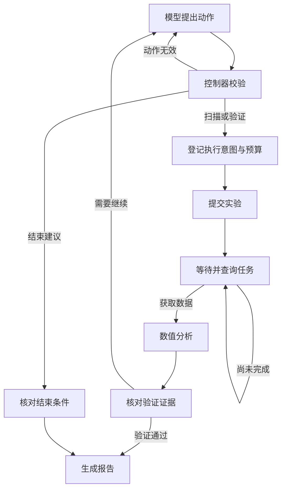

# 超导量子计算机校准 Agent：LangChain 与 LangGraph 技术实现方案

版本：v0.2（技术设计稿）

日期：2026-10-31

对应需求：[MVP_DESIGN.md](MVP_DESIGN.md)

状态：技术选型与实现设计；尚未实现或验证运行能力。

## 1. 技术结论与适用范围

建议采用 Python 作为实现语言，使用 LangChain 接入模型并生成结构化决策，使用 LangGraph 实现运行控制流程，使用独立的 Python 适配层提交实验、获取结果和完成数值分析。

本方案细化 MVP 设计中的职责、接口、状态和恢复机制，属于待实施的技术建议。模型接入已选定 DeepSeek API；具体服务地址、模型型号、输出能力、实验方案、数值阈值及真机接口仍需确认，不将示例参数或库接口示意视为已经完成验证的实现。

保留原 MVP 的范围：一个比特、一个目标参数、一种实验、一个决策 Agent、顺序执行、先使用模拟后端。本文以单比特共振频率搜索说明接口，不将其作为已经确定的首个实验。

核心职责如下：

- 模型根据测量与分析结果选择下一步动作，输出配置、证据引用和简短依据。
- 控制器检查动作是否允许，维护预算、停止规则、外部任务状态和恢复流程。
- 实验适配层负责提交、查询、取数及请求核对。
- 分析模块负责拟合、误差估计、数据质量判断和候选参数计算。
- 记录模块保存任务、动作、实验、分析、验证和报告之间的关联。

## 2. 组件选型

| 组件 | 对应需求 | 使用建议 |
| --- | --- | --- |
| LangChain 聊天模型接口 | 模型接入、提示词与响应管理 | 使用；供应商及模型名通过配置注入 |
| `with_structured_output()` 与 Pydantic | 结构化动作输出与字段验证 | 核心组件；按模型能力选择结构化输出方式 |
| LangGraph `StateGraph` | 决策、执行、分析、验证等状态流转 | 核心组件；显式定义节点与条件边 |
| `SqliteSaver` | 状态持久化、进程重启后恢复 | 本地 MVP 使用；内存型 saver 仅用于临时测试 |
| `RetryPolicy` | 模型与只读查询的有限重试 | 按节点和异常类型配置 |
| Streaming | 实时展示阶段、任务进度与分析结果 | 使用；事件由控制器或适配层产生 |
| `@tool` | 将业务函数暴露为模型可调用工具 | 按需使用；确定性节点可以直接调用业务函数 |
| `interrupt()` 与 `Command` | 等待外部输入后恢复 | 用于缺失信息、待核对等需要外部处理的情况 |
| LangSmith | 调用追踪、调试与评测 | 可选；先用本地结构化记录也能完成 MVP |
| NumPy、SciPy 等数值库 | 拟合、质量计算和不确定度估计 | 按具体实验选择；计算逻辑独立于模型 |

LangGraph 可以在同一流程中组合确定性程序和模型驱动步骤。[1] LangChain 的模型接口与结构化输出用于统一模型调用方式，但支持的方法取决于模型和供应商。[2]

### 2.1 `StateGraph` 与 `create_agent()` 的选择

LangChain 的 `create_agent()` 提供模型选择工具、执行工具并继续判断的循环。[3] 对当前 MVP，建议直接编写 `StateGraph`，在 `decide` 节点中调用一次模型，由外层流程执行经过校验的动作。

原因是本项目必须明确控制预算预留、实验提交、等待、提交结果核对和独立验证。显式节点便于检查这些业务边界，也便于使用固定策略替身测试异常流程。

后续如果决策阶段需要自由选择多个辅助分析工具，可以在决策节点内部引入 `create_agent()`，并保留外层控制器对实验提交和结束条件的检查。

### 2.2 MVP 暂缓引入的能力

当前不引入多 Agent、向量数据库、RAG 知识库、通用文件系统工具、任意 Python 执行工具或复杂任务规划器。先让受约束的实验闭环通过验收，再根据明确需求增加能力。

贝叶斯优化也不属于 LangChain 自动提供的校准算法。后续可将优化器封装为独立策略或候选点生成函数，模型负责选择何时使用以及如何解释结果。

## 3. 模块结构与依赖边界

建议目录如下。此表描述未来实现结构，不代表这些文件已经存在。

| 路径 | 职责 |
| --- | --- |
| `src/qagent/schemas.py` | 任务、动作、分析、验证和结果的数据模型 |
| `src/qagent/state.py` | LangGraph 状态定义与模型可见视图 |
| `src/qagent/graph.py` | 节点注册、条件边及图编译 |
| `src/qagent/policy.py` | 固定策略与模型决策策略的统一接口 |
| `src/qagent/controller.py` | 动作校验、预算规则与结束判定 |
| `src/qagent/backend/base.py` | 实验后端协议和统一错误类型 |
| `src/qagent/backend/simulator.py` | 可替换的模拟后端实现；核心模块不导入该模块 |
| `src/qagent/bootstrap.py` | 按配置创建后端并注入运行控制器，隔离具体实现的导入 |
| `src/qagent/analysis.py` | 确定性的数值分析与验证计算 |
| `src/qagent/storage.py` | 请求记录、预算账目、事件及结果引用 |
| `src/qagent/cli.py` | 启动、查看状态、请求停止和恢复 |
| `configs/` | 任务、模型及分析配置；不提交访问密钥 |
| `tests/` | 控制流程测试与真实模型决策评测 |
| `runs/<run_id>/` | 原始数据、分析结果、运行清单和报告 |

实验适配层、分析模块和预算规则尽量不依赖 LangChain。这样固定策略与模型策略可以共用相同执行逻辑，模拟后端与真机后端也可以实现同一套协议。

模拟隐藏真值、故障注入配置和随机条件由独立测试环境保管。模型可见上下文和分析接口均不得包含这些信息；若同进程运行，也必须通过明确的数据投影和访问测试检查边界。

### 3.1 模拟与真实实验系统的隔离约束

依赖方向固定为：Agent 和控制器依赖通用 schema 与后端协议；模拟适配器、真实适配器分别实现该协议；仅启动装配模块按配置导入并创建具体适配器，再通过构造参数注入控制器。后端包的初始化文件不得因加载通用协议而自动导入模拟器或设备 SDK。

| 层次 | 可以依赖的信息 | 不得绑定的模拟内容 |
| --- | --- | --- |
| DeepSeek 决策与提示词 | 实验说明、约束、预算、分析结果、可用能力 | 隐藏真值、随机种子、模拟场景名和故障计划 |
| LangGraph 与控制器 | 通用任务状态、错误类别、后端能力和任务编号 | 模拟器类型判断、固定延迟、立即返回结果的假定 |
| 工具与通用 schema | 业务实验配置、单位、数据引用和执行结果 | `true_frequency`、`noise_seed` 等模拟配置字段 |
| 数值分析 | 实测数组、单位、实验方法和分析配置 | 数据生成器、模拟内部参数、由真值产生的可识别目标标记 |
| 模拟适配器与测试环境 | 生成函数、噪声、隐藏真值、种子及故障注入 | 将内部配置回传为模型可见业务数据 |

物理实验知识可以进入实验说明和分析方法，例如扫描参数及适用的拟合模型；分析方法的适用性需要根据测量验证，不能因模拟器使用某个生成公式就默认真实实验一定服从该公式。

通过配置切换适配器，生产策略与控制器不编写 `if backend == "simulator"` 一类分支。允许范围、实验类型、请求检索和取消能力通过统一能力描述传入，配置只在启动装配处决定具体后端。后端来源可记录在运行元数据中用于追溯，但不据此跳过校验、预算或验证。

模拟依赖与真机 SDK 分别按需安装。真实系统接入时主要完成适配器、连接配置、单位及数据转换，以及必要的实验分析配置；具体设备前提、任务语义和物理效果仍需单独验收，不承诺更换配置即可直接完成真机校准。

## 4. 数据结构与模型上下文

### 4.1 主要对象

| 对象 | 建议字段 | 写入方 |
| --- | --- | --- |
| `CalibrationTask` | 比特、参数、单位、允许范围、初始条件、预算、成功判据 | 用户输入与启动校验 |
| `CalibrationState` | 运行编号、阶段、轮次、动作、当前任务、结果引用、候选、验证、错误 | 控制器与图节点 |
| `Decision` | 动作类型、对应参数、证据引用、简短依据 | 决策策略 |
| `ExperimentRequest` | 请求标识、固定配置、用途、预算预留、后端编号、提交状态 | 提交准备与适配层 |
| `AnalysisResult` | 数据引用、分析版本、估计值、不确定度、质量指标、问题 | 分析模块 |
| `VerificationResult` | 候选编号、独立数据引用、判据版本、是否通过 | 验证模块 |
| `RunOutcome` | 结束类别、原因、候选、证据、预算使用、局限 | 控制器 |

数值字段应体现单位，例如 `frequency_hz`、`uncertainty_hz`。采样点数与每点 shots 使用整数；具体上下限来自任务约定和后端能力。

图状态保存阶段推进所需的信息，原始测量数组单独保存为文件，状态中保留引用和摘要。运行清单记录代码版本、模型配置、提示词版本、分析版本和任务约定。

### 4.2 模型可见视图

每次调用模型时显式构造 `build_agent_view(state)`，包含：

1. 校准目标、允许范围、可用动作和预定成功判据。
2. 剩余实验预算、测量预算、时长及可重试次数。
3. 当前候选参数、最近分析摘要及必要的历史动作摘要。
4. 可引用的分析编号、验证编号和数据质量问题。
5. 上一次动作被拒绝的原因，或需要模型重新决策的错误。

控制器内部对象不自动全部进入提示词。密钥、设备连接、模拟隐藏真值和故障注入配置不属于模型输入。提示词只要求可见动作及简短依据，不要求记录模型内部推理过程。

## 5. 结构化决策

### 5.1 有限动作集合

| 动作 | 参数 | 含义 |
| --- | --- | --- |
| `scan` | 起止频率、采样点数、每点 shots | 覆盖粗扫、细扫、移动范围与增加重复测量 |
| `verify` | 已有候选参数编号 | 请求按预先定义的方案进行独立验证 |
| `finish` | 简短结束依据及证据引用 | 提出结束建议，最终状态由控制器确定 |

重做失败实验使用新的业务决策和预算检查；网络层重发同一个提交请求则遵循第 8 节的请求核对规则，两者分别记录。

### 5.2 接口示意

以下代码说明数据结构和模型调用边界，不是可独立运行的程序。`model`、提示词、可见视图构造函数及业务校验尚待实现；供应商对 schema 和输出方法的兼容性需要单独验证。

```python
from typing import Literal
from pydantic import BaseModel, ConfigDict, Field


class ScanConfig(BaseModel):
    model_config = ConfigDict(extra="forbid", allow_inf_nan=False)

    start_hz: float
    stop_hz: float
    points: int = Field(ge=3)
    shots_per_point: int = Field(gt=0)


class Decision(BaseModel):
    model_config = ConfigDict(extra="forbid")

    action: Literal["scan", "verify", "finish"]
    scan: ScanConfig | None = None
    candidate_id: str | None = None
    evidence_ids: list[str]
    reason: str


decision_model = model.with_structured_output(Decision)


def decide(state):
    visible = build_agent_view(state)
    decision = decision_model.invoke([
        ("system", decision_instructions),
        ("human", visible.model_dump_json()),
    ])
    return {"decision": decision.model_dump()}
```

这里 `points >= 3` 只是 schema 示例，不是足够完成实际拟合的采样要求。正式规则应由实验和分析方法决定。

### 5.3 两级校验

Pydantic 检查字段类型和局部约束。控制器另行检查以下业务规则：

- 动作与参数匹配：扫描必须有配置；验证必须引用已有候选；结束不能夹带未执行配置。
- 频率有限且起点小于终点，整个范围落在任务授权范围内。
- 点数与 shots 满足后端能力和拟合需要，测量消耗按约定计算。
- 引用的证据确实属于本次运行，候选与证据关系正确。
- 预算仍然允许本次动作，且没有待核对任务或停止请求。

非法动作返回明确错误码和原因，让模型在有限次数内修正。预算、权限和证据规则不能仅依赖提示词约束。

## 6. LangGraph 流程设计



该图展示主流程。正式实现还需增加错误、预算耗尽、停止和待核对分支；这些事件可以在多个节点触发。

| 节点 | 实现职责 | 是否调用模型 |
| --- | --- | --- |
| `initialize` | 核对任务、前置条件和后端能力 | 否 |
| `decide` | 根据可见结果生成结构化动作 | 是；阶段 B 使用固定策略替身 |
| `validate` | 检查动作、证据、预算、停止标志和活动任务 | 否 |
| `prepare_submission` | 固定请求标识和配置，幂等登记意图并预留预算 | 否 |
| `submit` | 调用后端，记录任务编号或不明确结果 | 否 |
| `wait_result` | 查询任务状态、等待并取数 | 否 |
| `analyze` | 拟合、误差估计和质量计算 | 否 |
| `check_verification` | 绑定候选与验证数据，核对预定判据 | 否 |
| `reconcile` | 核对提交结果不明确的请求 | 否 |
| `finalize` | 确定结束类别并生成有证据的报告 | 否 |

实验等待由控制器管理，模型不参与重复轮询。MVP 可以在等待节点中按间隔查询，持续检查停止状态并保存关键变化；节点有明确时限。若用图自循环逐次查询，需同时配置轮询间隔、总时限及足够的图步数限制，不能把框架的步数限制当成实验预算。

验证动作沿用提交与取数流程，但实验用途标记为 `verification`，配置由预先定义的验证规则和候选参数共同生成。独立验证使用新的测量数据及预先确定的判据，不以重新读取同一份拟合结果代替验证。

## 7. 实验与分析接口

### 7.1 后端协议

| 接口 | 输入 | 输出或语义 |
| --- | --- | --- |
| `submit_experiment` | 固定配置、请求标识 | 已接受及任务编号、明确拒绝，或提交结果不明确 |
| `get_job_status` | 后端任务编号 | 排队、运行、完成、失败，或暂时无法确认 |
| `fetch_result` | 后端任务编号 | 数据引用、单位、采样配置、后端元数据 |
| `find_job_by_request` | 请求标识 | 已有任务、能够确认不存在，或无法核对 |
| `cancel_job` | 后端任务编号 | 可选能力；取消请求不等于取消已完成 |

后端能力应在启动时明确，例如是否支持提交去重、按请求标识检索、取消任务。不能为不支持的后端伪造恢复保证。

所有后端通过同一套契约测试。模拟后端可以通过可控时钟加速测试，但对外仍保留排队、运行、完成、失败和无法确认等业务语义。控制器不得根据模拟器的计时实现或任务编号格式决定业务行为。真实数据转换在适配层完成，通用数据包含单位、采样配置和有效性信息；设备原始元数据另行保留以便追溯。

### 7.2 分析接口

`analyze_spectrum(data_ref, analysis_config)` 返回参数估计、不确定度、质量指标、拟合状态、方法版本与输入引用。没有可信结果时返回明确的质量问题，不把函数执行成功当成物理结论可信。

模拟测试可使用简单含噪响应，例如在选定实验中适用的峰形或谷形，重点覆盖可决策分支。具体模型、拟合方法及不确定度定义需在实验方案确认后固定。

### 7.3 与 `@tool` 的关系

`@tool` 将函数名称、说明和参数结构提供给模型。[4] 它不会自动生成设备驱动、实验方法、预算规则或恢复机制。

当前架构由图节点直接调用适配层即可。只有需要模型主动选择的辅助函数，才考虑包装成模型可调用工具。若未来开放实验工具，工具内部仍必须调用同一套控制器校验和请求管理逻辑，防止绕过执行约束。

## 8. 持久化、预算与外部任务恢复

### 8.1 两类持久化

| 持久化对象 | 作用 | MVP 建议 |
| --- | --- | --- |
| 图 checkpoint | 记录图运行到哪里、当前状态是什么 | `SqliteSaver`，使用 `run_id` 作为 `thread_id` |
| 业务记录 | 记录实验意图、后端任务、预算、事件、数据和验证证据 | 独立业务表和结果文件 |

内存型 checkpointer 不保留进程重启后的状态；SQLite 适用于本地开发场景。[5] checkpoint 只承担图状态恢复，不代替外部实验的请求核对。

图编译时传入 checkpointer，每次新运行使用新的 `run_id`，恢复时复用原编号。关键提交边界应确保记录已经持久化，具体 durability 配置和 saver 生命周期在实现时按锁定版本确认。[6]

### 8.2 提交协议

1. 接受动作后，生成本次逻辑实验的稳定 `request_id` 并固定实验配置。
2. 在业务事务中登记执行意图和预算预留；对请求标识设置唯一约束，重复恢复不重复扣账。
3. 提交前再次检查持久化停止标志，并确保同一运行只有一个执行者进入提交临界区。
4. 向后端提交固定请求；支持后端去重时，始终使用同一个请求标识。
5. 收到任务编号后记录映射，后续继续查询该任务。
6. 明确未接受时按约定释放预留；已接受时按约定记账；结果不明确时保留预留并进入核对流程。

预算至少区分已使用与已预留，下一次可用预算从两者共同计算。验证实验也计入预算；失败任务、重做任务和实际测量消耗的记账规则在任务约定中固定。

### 8.3 恢复规则

| 恢复时已有信息 | 处理方式 |
| --- | --- |
| 已有后端任务编号 | 查询已有任务，不创建新实验 |
| 已有原始数据 | 复用数据，继续分析或验证 |
| 已有对应分析结果 | 检查输入和方法版本后复用 |
| 已有请求意图但没有任务编号 | 先按请求标识核对后端 |
| 后端无法确认请求是否接受 | 保持待核对，阻止新实验并报告 |

尤其要覆盖“后端已接受，程序在保存任务编号前崩溃”的窗口。图 checkpoint、节点拆分和同步保存可以缩小风险窗口，但不能单独保证外部实验恰好执行一次。节点重试或恢复可能重做已经发生的外部操作，需要后端幂等能力或可靠核对机制。[7]

### 8.4 重试和停止

`RetryPolicy` 按节点和异常类型配置。[8] 模型限流或只读状态查询的临时故障可有限重试；动作非法应返回决策阶段；实验物理失败应保留记录后重新决策；提交结果不明确必须先核对。

统一模型 SDK、HTTP 客户端和图节点的重试次数及总时限，防止多层重试叠加。重试消耗仍受任务时长和调用预算约束。

停止请求写入持久化控制记录，等待期间和每次新提交前读取。若停止与提交并发，按提交临界区的先后顺序记录已发生的行为；已被后端接受的任务单独跟踪。收到停止请求后不再发起后续新实验，是否取消活动任务取决于后端能力。

`interrupt()` 可用于等待外部输入；恢复时节点会从头执行，不能把它当成设备取消机制，也不应在其前方放置无法去重的实验提交。[7]

## 9. 实时进度与运行记录

控制器在动作接受、任务提交、状态变化、数据获取、分析完成、验证完成及结束时产生结构化事件。事件至少含 `event_id`、`run_id`、轮次、时间、类型及相关对象编号。

示例中的预算数字仅用于展示事件格式：

```json
{
  "event_id": "event_007",
  "event": "analysis_completed",
  "run_id": "run_001",
  "iteration": 2,
  "analysis_id": "analysis_002",
  "quality": "low_snr",
  "remaining_measurements": 12000
}
```

事件先持久化，再用于实时展示；通过唯一事件编号或序号支持重连后的补读与去重。Streaming 提供实时传输，不自动代替永久事件日志。

LangGraph 提供状态更新、自定义事件和模型消息等流式能力；当前官方文档推荐新应用优先考虑 event streaming。[9] MVP 可先输出 CLI 进度，后续界面复用同一事件模型。

LangSmith 可辅助查看模型调用、工具调用和评测轨迹，但运行事实仍以本地业务记录及后端任务状态为依据。是否接入远程追踪需结合实验数据传输边界确定。

最终报告包含：目标、结束状态及原因、候选参数和单位、不确定度、独立验证证据、预算使用、策略调整经过和局限。模型提出 `finish` 不能直接写入成功状态；只有控制器确认预定验证条件满足后，才能输出校准成功。

## 10. 实施阶段与验收

| 阶段 | 实现内容 | 完成依据 |
| --- | --- | --- |
| A：约定细化 | 固定实验、单位、后端能力、预算、质量和验证判据 | 数据结构和规则相互一致 |
| B：运行闭环 | 模拟后端、固定策略、LangGraph、SQLite、CLI 与记录 | 控制流程及异常测试通过 |
| C：模型决策 | 替换 `decide`，接入真实模型及结构化动作 | 相同任务下能根据不同数据作出有依据的不同动作 |
| D：综合评测 | 多噪声场景、重复运行、固定策略对比和独立验证 | 达到预先确定的验收指标 |
| E：真机适配 | 实现真实适配层，确认单位、任务语义及设备前提 | 通过单独制定的真机验收 |

重点测试如下；这些是后续实现要求，不代表本轮已经执行。

| 测试 | 关键断言 |
| --- | --- |
| 正常闭环 | 有调整、独立验证和可追溯报告；与隐藏真值比较由测试器完成 |
| 低信噪比与无目标 | 合理调整或明确停止，不产生虚假成功 |
| 非法动作 | 越界、无效配置和伪造证据在到达后端前被拒绝 |
| 预算与停止 | 预留及使用不重复记账；停止后无后续新实验 |
| 中断恢复 | 提交前、接受后未存编号、取数后、分析后中断均有明确恢复行为 |
| 提交不明确 | 先核对；无法核对时保留状态，不盲目重提 |
| 验证失败 | 继续调整或未收敛结束，不以拟合结果替代验证 |
| 重试限制 | SDK 与图层重试次数、总时长受约束 |
| 可见数据边界 | 模型和分析接口均无法读取模拟隐藏真值或故障配置 |
| 模拟依赖隔离 | 核心模块不导入模拟器或真机 SDK；未安装模拟依赖时仍能加载核心模块 |
| 后端替换 | 同一控制流程注入另一套协议兼容测试后端，覆盖排队、失败和提交结果不明确 |
| 配置与分析边界 | 隐藏真值、种子、噪声及故障配置不进入通用任务、生产提示词或分析输入 |
| 后端契约 | 模拟与真实适配器执行同一组协议测试；设备差异由能力描述和适配层处理 |
| 模型适配 | 真实服务能返回有效 schema，异常格式有明确处理路径 |

运行控制测试使用固定策略和故障注入稳定复现。决策有效性测试必须接入真实模型，记录动作、证据引用和失败案例。评测前固定场景、随机条件、预算、阈值及成功率目标，不能仅凭一次成功运行验收。

按 `AGENTS.md` 管理代码更新：每轮更新先完成相匹配的测试与验证，再创建独立 Git 提交。每次实验保存运行编号和代码版本，实验循环内部不逐轮创建代码提交。

## 11. 依赖与待确认事项

拟使用的直接依赖包括 `langchain`、`langgraph`、`langgraph-checkpoint-sqlite`、`pydantic` 和 DeepSeek API 对应的模型集成包；实验需要时加入 `numpy`、`scipy`，测试阶段加入 `pytest`。模拟生成代码的专用依赖和真机 SDK 分别放入可选依赖组，不作为核心模块加载的前提；分析本身需要的数值库可作为分析模块依赖。不在设计阶段虚构已经验证的版本组合。首次实现应检查 Python 与包版本兼容性，验证真实模型接口后锁定依赖。

下一步需要确定：

1. 首个实验及可假定已完成的前置标定。
2. 模型服务的访问方式、工具调用和结构化输出能力。
3. 精度、质量、不确定度和独立验证规则。
4. 测量预算、实验轮次、超时及重试的记账口径。
5. 真机后端是否支持请求去重、任务检索和取消。

本轮只交付技术文档。文档检查不构成依赖兼容性、模型调用、运行恢复或真机校准效果的验证。

## 12. 官方参考资料

以下链接为本轮讨论核对的官方文档入口；实现时应以锁定版本的接口为准。

1. [LangGraph overview](https://docs.langchain.com/oss/python/langgraph/overview)：流程编排、确定性与模型驱动步骤。
2. [Models](https://docs.langchain.com/oss/python/langchain/models)：模型接口、结构化输出和供应商能力差异。
3. [Agents](https://docs.langchain.com/oss/python/langchain/agents)：`create_agent()` 与模型工具循环。
4. [Tools](https://docs.langchain.com/oss/python/langchain/tools)：`@tool`、参数 schema 与工具接口。
5. [Persistence](https://docs.langchain.com/oss/python/langgraph/persistence)：checkpointer、store 与持久化选择。
6. [Checkpointers](https://docs.langchain.com/oss/python/langgraph/checkpointers)：checkpoint、线程及恢复管理。
7. [Interrupts](https://docs.langchain.com/oss/python/langgraph/interrupts)：暂停恢复、节点重放和外部操作幂等性。
8. [Fault tolerance](https://docs.langchain.com/oss/python/langgraph/fault-tolerance)：节点重试、超时与错误处理。
9. [Event streaming](https://docs.langchain.com/oss/python/langgraph/event-streaming) 与 [Streaming](https://docs.langchain.com/oss/python/langgraph/streaming)：事件投影与流模式。
