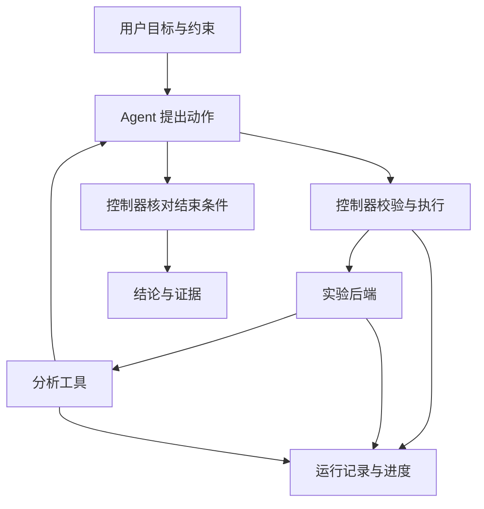

# 超导量子计算机校准 Agent：MVP 设计方案

版本：v0.2（设计稿）

日期：2026-10-31

状态：设计阶段；尚未实现或验证系统运行能力。

## 1. 目标与范围

长期目标是建立面向超导量子计算机真机参数校准的 Agent 系统，完成实验参数设置、实验代理执行、结果获取与分析、策略调整和校准结果管理。

MVP 的目标是验证一个完整且可追踪的 Agent 闭环：接收校准任务，根据已有结果选择行动，调用实验与分析工具，在约束内迭代，并给出有证据的结论或明确的停止原因。

架构闭环验证与真机校准效果验证分开进行。MVP 首先使用模拟实验后端；该阶段的通过不代表系统已经具备真机校准效果。真机接入沿用相同职责边界，但设备接口、单位、任务语义及参数写回仍需单独验证。

模拟实现必须与 Agent 核心架构解耦。Agent、运行控制器和分析模块面向统一的实验任务、状态、数据及错误约定工作，不依赖模拟器的类、生成函数或内部配置。模拟器只是可替换的实验后端；切换真实实验系统时，主要新增或替换适配层、连接配置和必要的实验分析配置，保持决策与运行控制逻辑可复用。

本方案只定义行为、职责和验收要求，不决定模型供应商、Agent 框架、编程语言、数据库、界面形式或具体实验算法。

| 范围 | MVP 约定 |
| --- | --- |
| 校准对象 | 一个比特、一个目标参数、一种实验 |
| Agent | 一个负责实验决策的 Agent |
| 执行方式 | 顺序执行，一次处理一个实验任务 |
| 实验后端 | 模拟后端，具有提交、等待、完成和失败语义 |
| 策略调整 | 依据分析结果调整下一轮实验配置 |
| 交付结果 | 验证过的候选参数、证据和运行记录 |
| 暂缓内容 | 多 Agent、多比特联合校准、多任务调度、实验依赖图、知识库、复杂界面、自动写回真机参数 |

## 2. 测试场景

建议以“单比特共振频率搜索”作为参考场景，最终实验类型待确认。架构不依赖这一选择。

任务示例：在指定频率范围内寻找目标比特的共振频率，根据结果调整扫描范围、采样密度和重复测量次数，在实验预算内满足预定精度要求。

模拟后端生成含噪声的测量数据，支持正常响应、低信噪比、范围内无可识别目标、任务失败及延迟等测试条件。模拟响应只需足以触发决策分支，不承担高保真芯片仿真的目标。

真实参数和故障注入配置由测试环境保管，不进入 Agent 上下文或分析工具的可见数据。Agent 只能获得正常工具接口提供的测量与分析结果。

模拟噪声、随机种子、隐藏真值、故障和延迟注入配置只属于模拟后端与测试环境，不进入通用任务字段、生产提示词或策略分支。数据是否含有可识别目标必须依据实际测量和分析判断，不能由模拟器直接告知。模拟接口也应支持提交、等待、失败及提交结果不明确等语义，不能要求控制器假定实验立即返回完整结果。

测试场景的价值是检验 Agent 会不会因结果不同而改变行动，而不是仅按固定步骤重复运行。

## 3. 角色与职责

| 角色或模块 | 职责 | 输出或约束 |
| --- | --- | --- |
| 用户 | 提出目标，设定允许范围、预算与成功标准，查看进度，发起停止 | 任务约定 |
| 决策 Agent | 理解任务，选择实验动作，解释调整依据，提出结束建议 | 结构化动作与简短依据 |
| 运行控制器 | 校验动作，驱动执行，维护状态，执行预算和停止规则，处理恢复 | 已执行动作、状态和事件 |
| 实验工具与后端适配层 | 翻译实验配置，提交任务，查询状态，获取数据 | 任务编号、状态、原始结果 |
| 分析工具 | 完成拟合、误差估计、质量评估与候选参数计算 | 可重复计算的分析结果 |
| 记录模块 | 保存任务约定、动作、实验、数据、分析和结论之间的关系 | 可追踪的运行记录 |

Agent 负责选择行动。运行控制器负责判断行动是否允许并实际执行。分析工具负责数值计算。模型提出成功结束建议后，控制器还必须检查是否存在必要的验证证据。

不要求保存模型的内部推理过程；保存可见动作、简短决策依据和所引用的结果即可。

## 4. 任务约定与交互

启动前形成明确的任务约定。必要信息不足时先补齐，不能由 Agent 猜测设备允许范围。

| 信息 | 要求 |
| --- | --- |
| 目标 | 比特、参数名称、校准目的与参数单位 |
| 初始条件 | 当前估计、允许范围、可用实验、适用前提 |
| 预算 | 最大实验轮次、测量预算、总时长及可重试次数 |
| 成功标准 | 估计精度、数据质量和独立验证要求 |
| 结束规则 | 成功、预算耗尽、无法找到目标、不可恢复错误或用户停止 |

Agent 每次提出动作时提供：动作类型、对应配置、关联结果和简短依据。工具返回值至少区分成功、等待、失败和无法判断，包含结果引用或可处理的错误信息。所有数值具有明确单位，分析结果能够追溯到原始测量。

用户可以查看当前阶段、最近结果、下一步计划和剩余预算；可以要求停止。停止请求应阻止新实验提交。已在执行的实验是否能取消由后端能力决定，不能把停止请求直接当成设备任务已取消。

## 5. 校准闭环

1. 接收任务：核对目标、允许动作、实验前提和预算。
2. 形成初始方案：Agent 选择首轮实验配置。
3. 执行前检查：控制器核对范围、单位、预算和动作合法性。
4. 提交实验：获得可追踪的任务编号，进入等待阶段。
5. 获取结果：控制器维护等待与状态查询，完成后交给分析工具。
6. 分析与决策：Agent 阅读估计值、不确定度、质量指标及错误信息，选择下一步。
7. 验证候选参数：使用预先定义的独立验证测量或判据检验候选结果。
8. 结束并报告：控制器核对证据，输出成功、未收敛、失败或停止结论。

第 6 步允许的动作应有限且明确，例如：缩小或移动扫描范围、改变采样密度、增加重复测量、在剩余预算内重试、进入验证、停止。MVP 不开放任意修改分析程序或执行任意代码的能力。

参考决策示例：识别到可信峰后细扫；质量不足且预算允许时增加测量；验证失败时返回实验阶段；没有可信目标且允许范围已用尽时报告未找到。具体阈值与实验模型在实验方案确定后定义。

实验等待由控制器处理。Agent 在有新结果、可决策错误或约定的异常事件出现时再参与，避免让模型承担重复轮询。

## 6. 状态、异常与恢复

| 状态 | 含义与允许行为 |
| --- | --- |
| 待就绪 | 核对任务信息及实验前提 |
| 决策中 | Agent 选择下一步动作 |
| 待执行 | 控制器检查动作并登记执行意图 |
| 实验等待中 | 已提交任务，查询状态或等待结果 |
| 分析中 | 处理已经获取的数据 |
| 验证中 | 执行候选参数验证 |
| 待核对 | 外部任务是否提交或完成暂时无法确定，先核对后端状态 |
| 已结束 | 标明成功、未收敛、失败或停止，并保留原因 |

在动作被接受、提交意图登记、任务编号获得、数据获取、分析完成及结束等关键位置保存状态。

重点处理以下异常：

- 非法或越界动作：控制器拒绝执行，向 Agent 返回具体原因；连续无效动作达到上限后结束。
- 可恢复的模型或查询错误：按约定次数重试，并计入对应时长或调用限制。
- 实验失败：保留失败任务记录，是否重做由错误性质、策略与剩余预算共同决定。
- 提交结果不明确：不得把网络超时视为提交失败后直接重新提交；优先通过请求标识或任务查询核对。
- 无法确认外部任务状态：保持待核对并显式报告，不能宣称已避免重复提交或已成功恢复。
- 拟合不可信：返回质量问题，允许调整实验；不能把工具返回成功等同于物理结论可信。
- 预算耗尽或用户停止：停止发起新实验，保存已有结果，说明尚未满足的条件。

恢复后优先继续查询已有任务或复用已保存的数据和分析，避免无故重复已完成的实验。后端是否支持请求去重和任务检索，需要在真机适配阶段确认。

后端通过统一接口声明允许范围、可用实验、数据格式、请求去重、任务检索和取消等能力。控制器按能力和任务约定执行，不使用“模拟模式”专用分支跳过校验、预算、等待、恢复或独立验证。真实后端不支持的能力必须明确报告，不能沿用模拟器的假定。

## 7. 结果、记录与可观测性

一次完整运行至少记录以下内容：

| 对象 | 必须保留的信息 |
| --- | --- |
| 运行 | 唯一运行编号、任务约定、起止时间、结束状态 |
| 决策 | 轮次、动作、配置、依据及关联结果 |
| 实验 | 请求标识、后端任务编号、状态、原始数据引用 |
| 分析 | 输入数据引用、使用的方法及版本、参数估计、不确定度、质量指标 |
| 验证 | 验证配置、测量结果、判定标准和是否通过 |
| 可复现配置 | 代码版本、模型配置、提示词版本、实验与分析配置；模拟测试另存随机条件 |

实时进度至少能回答：现在处于哪个阶段、已经完成什么、为什么调整方案、下一步做什么、剩余多少预算。进度信息来自真实状态和事件，不能由模型凭空补充。

最终报告说明目标、推荐参数及单位、不确定度、验证证据、使用预算、调整经过、结束原因和局限。没有通过验证时，不输出“校准成功”。

代码版本与实验版本分开管理：代码按 AGENTS.md 逐轮独立提交；每次实验使用唯一运行编号并记录代码版本。运行中的实验轮次不要求逐轮创建 Git 提交。

## 8. 验收方案

以下是未来实现后的测试要求，不代表已经执行或通过。验收分为“运行控制正确”和“Agent 决策有效”两类，均通过才算 MVP 完成。

| 场景 | 预期结果 | 验证依据 |
| --- | --- | --- |
| 正常实验 | 完成测量、调整、独立验证和报告 | 完整记录与模拟隐藏真值对比 |
| 信噪比不足 | 根据质量结果合理增加测量或调整方案 | 动作与工具结果的关联记录 |
| 范围内无目标 | 报告无法确认目标或预算耗尽 | 无虚假成功结论，无范围越界 |
| 越界或非法动作 | 执行前拦截，给出明确原因 | 后端没有接收到被拒绝实验 |
| 实验或模型错误 | 有限重试、合理恢复或明确结束 | 重试记录、预算和结束原因 |
| 运行中断 | 重新启动后继续已有任务或已有数据 | 中断前后任务关联与提交次数 |
| 提交结果不明确 | 先核对，无法核对时进入待核对状态 | 不盲目重提，不虚报恢复成功 |
| 达到预算或请求停止 | 不再发起新实验，保存结果 | 后续提交记录和最终状态 |
| 候选验证失败 | 继续调整或以未收敛结束 | 不以首轮拟合替代验证 |
| 数据访问边界 | Agent 无法读取模拟隐藏真值 | 可见上下文、工具数据与测试配置检查 |
| 后端可替换性 | 更换接口兼容的测试后端后，决策和控制逻辑仍可运行 | 同一组后端契约测试，覆盖排队、失败和提交结果不明确 |
| 模拟依赖隔离 | 核心模块不导入模拟实现，通用任务与提示词无模拟专用字段 | 依赖检查、配置边界检查；模拟依赖未安装时仍能加载核心模块 |

运行控制测试可以使用固定决策替身，以便稳定复现异常。Agent 决策测试必须接入真实模型，并证明：在相同任务目标下，正常数据与低质量数据能够触发有依据的不同动作。

评测前固定场景、预算、精度、成功率目标和允许的策略集合，采用多个噪声条件重复评测，同时记录失败案例和相对固定策略的表现。不能仅凭一次成功运行判定系统可靠。具体数值在实验场景确定后补充，不将示例阈值视为真机要求。

## 9. 阶段划分与交付物

| 阶段 | 设计或验证目标 | 完成标志 |
| --- | --- | --- |
| A：设计定稿 | 确定场景、职责、状态、动作与验收口径 | 关键约定完整且相互一致 |
| B：运行闭环验证 | 使用模拟后端和固定策略验证执行、记录、预算与恢复 | 运行控制验收通过 |
| C：Agent 闭环验证 | 模型依据结果选择下一步动作 | 自适应决策验收通过 |
| D：MVP 综合验收 | 多场景重复运行，输出完整证据 | 达到预先约定的验收标准 |
| E：真机适配 | 核对接口、设备前提、任务语义和实验效果 | 单独定义并完成真机验收 |

MVP 最终应交付任务约定、架构与状态说明、可运行样例、测试结果、示例运行记录及实验报告。当前轮只交付本设计稿。

## 10. 后续需要确定的事项

1. 首个实验选择：共振频率搜索，还是已有稳定流程的其他单参数校准。
2. 已有实验的依赖与可用接口：哪些前置标定可以假定已完成，哪些必须检查。
3. 模型接入条件：可用服务、工具调用能力和数据传输边界。
4. 验收参数：精度、质量阈值、预算、测试样本及成功率目标。
5. 真机接入时的权限：实验参数设置、候选参数保存与设备持久参数更新分别如何授权。

以上事项影响后续实现和验收细节，不妨碍当前架构设计。多 Agent、贝叶斯优化策略、跨实验依赖和自动参数写回可在基础闭环验证后逐项扩展。
