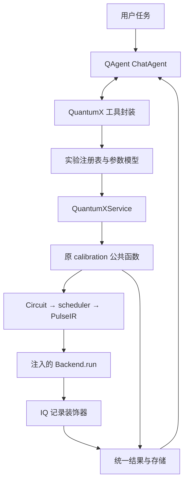

> 历史设计文档：当前 0.5.0 已移除示例模块并改为真机专用入口，使用方式请以 [当前说明](QUANTUMX2_USAGE.md) 为准。

# QuantumX2 函数与模块的 Agent 接入设计

日期：2026-11-01。对象：D:\QAgent\QuantumX2 当前工作树。

范围：函数、模块、参数和结果如何接入 QAgent；不讨论真机部署、设备连接、驱动、硬件保护或进程服务。QuantumX2 的原有内容不作修改。0.4.0 已实现首批三个函数的接入，实际用法见 [接入说明](QUANTUMX2_USAGE.md)；下文保留设计和后续扩展方向。

## 1. 推荐接入点

优先在 QAgent 侧封装 QuantumX2 已有的 calibration 公共函数，复用当前模型的工具调用能力。原实验函数继续完成序列构造、IQ 获取和数值拟合，Agent 负责选择实验、组织参数、读取结果和决定是否调整参数。

这比先把整个 QuantumX2 转换为一个新 Agent 框架更直接。QuantumX2 作为普通 Python 库依赖保留，新增代码均位于 QAgent。



## 2. 原代码中的模块边界

| 模块 | 当前职责 | 接入用途 |
| --- | --- | --- |
| [calibration.py](../../QuantumX2/src/quantumx/calibration.py) | 标定实验及拟合，公共函数接收 backend、配置路径、update、show_plot | 主要业务函数接入点 |
| [circuit.py](../../QuantumX2/src/quantumx/circuit.py) 与 [gates.py](../../QuantumX2/src/quantumx/gates.py) | 电路对象及 RotPulse 等原生门 | 原标定函数已复用；新增实验时组合使用 |
| [scheduler.py](../../QuantumX2/src/quantumx/scheduler.py) | Circuit/CompiledCircuit 转换为 PulseIR | 执行链路复用，不需要改其内部结构 |
| [pulse_ir.py](../../QuantumX2/src/quantumx/pulse_ir.py) | 声明式脉冲事件及 JSON 序列化 | 可随实验记录保存实际执行序列 |
| [backend/base.py](../../QuantumX2/src/quantumx/backend/base.py) | session 与 run(PulseIR, shots) 返回 IQ | 利用已有注入接口增加记录装饰器 |
| [readout.py](../../QuantumX2/src/quantumx/readout.py) | IQ 分类 | 供原实验函数生成概率等派生分析，原始数据仍保留 IQ |
| [config.py](../../QuantumX2/src/quantumx/config.py) | 读取结构化配置 | 由服务上下文提供配置，不让模型选择任意文件 |
| [compiler/qasm.py](../../QuantumX2/src/quantumx/compiler/qasm.py) | QASM 编译 | 电路类工具的后续扩展，不是现有标定函数的必经入口 |
| [cli.py](../../QuantumX2/src/quantumx/cli.py) | 命令行串联执行 | 不依赖解析其终端输出，封装层直接调用 Python 函数 |

当前目录没有旧目录中的 ssh.py/spectroscopy()。freqtuner() 是 Ramsey 精调，不能按名字把它当成宽范围频谱扫描函数。本方案以当前已有 calibration 函数为首批接入对象。

## 3. 函数到 Agent 工具的映射

前三个执行工具已实现，其余为后续拟议名称；均由 QAgent 侧注册，QuantumX2 原函数不变。

| 用户意图 | Agent 工具 | 原函数 | 返回给模型的主要摘要 |
| --- | --- | --- | --- |
| 计算读出中心 | measure_readout_centers | calc_readout_centers | center0、center1、验证 fidelity、IQ 引用 |
| 调整 pi 脉冲幅度 | tune_pi_amplitude | pituner | best_piAmp、拟合质量、曲线/IQ 引用 |
| Ramsey 精调频率 | tune_frequency_ramsey | freqtuner | best_f10、correction、T2Star、r_squared |
| 调整 DRAG 系数 | tune_drag_alpha | dragAlphaIntersection | best_alphaDRAG、交点拟合结果 |
| 比较读出振幅 | tune_readout_amplitude | readoutAmpFid | 最佳读出振幅、保真度及分析结果 |
| 比较读出 Z 参数 | tune_readout_z_amplitude | readoutZpaFid | 最佳读出 Z 参数和保真度 |
| 评估单比特门 | evaluate_single_qubit_rb | sqRbClifford | average_gate_fidelity、error_per_gate、拟合摘要 |

第一轮只实现前三个工具，先贯通参数和结果，再增加其他函数。统一提供 describe_experiments、get_experiment_result 和 compare_experiment_results，供 Agent 查询已注册能力及比较已有结果。

## 4. QAgent 侧新增模块

```text
src/qagent/integrations/quantumx/
├── registry.py          # 实验定义和固定函数映射
├── parameters.py        # 各实验独立的参数模型
├── service.py           # 调用原函数、关联上下文和结果
├── recording_backend.py # 代理 Backend，记录每次 run 返回的 IQ
├── results.py           # 通用实验结果及 NumPy 序列化
└── tools.py             # 模型可见的工具定义
```

### registry.py

每项 ExperimentDefinition 描述实验名称、对应函数、参数模型、扫描轴、结果提取规则及判据。使用显式注册表，避免把模型生成的字符串当任意模块路径导入执行。

### parameters.py

针对不同函数单独建参数模型。例如：

- ReadoutCentersParameters：n、shots、validation_fraction。
- RabiParameters：n、振幅起止、点数、shots。
- RamseyParameters：n、delay 起止（秒）、点数、fringe_freq（Hz）、shots。

服务层将起止和点数转换成函数需要的 amps/delays 数组，单位明确，不要求模型输出 NumPy 代码。配置上下文、backend、update 和 show_plot 不由模型直接填写。

### service.py

拟议调用顺序：参数校验 → 创建实验记录 → 调用固定函数 → 保存原始结果/IQ → 提取摘要 → 返回结果编号。

封装层固定传 update=False、show_plot=False。需要把候选值用于下一轮时，在 QAgent 的运行目录生成配置副本并传入 qubits_config；不修改 QuantumX2 的原始配置。每轮保存使用的参数和配置副本关联，便于复现。

## 5. 无需修改原函数，如何保留 IQ

calc_readout_centers 已直接返回 iq0/iq1。但 pituner/freqtuner 等函数虽然内部采集了 IQ，最终主要返回 P(1) 曲线与拟合值；例如内部使用 prob, _ 接收结果后丢弃 IQ。因此仅包装返回字典不足以保证 IQ 可追溯。

解决办法是在 QAgent 中写 RecordingBackend，利用所有这些函数已有的 backend 参数进行组合：

1. session() 委托给原 backend.session()。
2. run(pulse_ir, shots) 委托给原 backend.run()。
3. 原样保存 IQ、副本化 PulseIR、shots 和 call_index。
4. 将同一份 IQ 返回给原函数，原来的分类与拟合不受影响。

记录器不重新采样、不改变数组，不替换 QuantumX2 的私有函数，也不用 monkey patch。该模式可对已有测试后端使用。

函数返回后，由对应 ExperimentDefinition 将调用顺序与实验轴关联：读出中心是 state=0/1；Rabi 是 amp；Ramsey 是 delay 与 X/Y 两组。关联规则须按实际函数调用顺序逐项测试，不能只靠数组形状猜测含义。异常时已经记录的 IQ 仍保存。

## 6. 结果契约

当前 QAgent 的 Measurement 虽然已默认 IQ，但仍要求 frequencies 和 ScanConfig，适合频谱实验；Rabi 的振幅轴、Ramsey 的时间轴、读出中心的状态标签不能伪装为 Hz。

建议新增与旧频谱契约并存的 ExperimentResult：

| 字段 | 含义 |
| --- | --- |
| experiment_id / experiment_type | 实验身份和注册类型 |
| target / parameters | 目标与本轮明确的函数参数 |
| axes | 轴名称、单位及数值，例如 amplitude 或 delay_s |
| iq_records | 各次采集的 IQ 引用、shots、序号及轴/状态标签 |
| metrics | 原函数返回的标量及拟合指标 |
| curves | NumPy 曲线的受控文件引用 |
| quality | 按实验定义计算的可接受/需调整/无法判定状态 |
| artifacts | 报告、配置副本、PulseIR 及完整结果的引用 |

原始 I/Q 可复用现有 IQData 的表示方式，但外层不强制套用频率测量对象。NumPy 数组和标量通过统一序列化转换或保存为数组文件；不要直接交给 json.dumps，也不要把长数组塞进模型上下文。

原函数给出 best_f10/best_piAmp 只代表拟合候选，是否满足任务目标由该实验的判据决定。readout fidelity、Rabi 拟合与 Ramsey 拟合分别使用各自指标，不能统一套用 Lorentzian 分析。

## 7. 与现有 Agent 模块的关系

[ChatAgent](../src/qagent/chat.py) 已通过工具调用理解自然语言，可以复用。新增 create_quantumx_tools(service)，在现有工具组装位置加入工具即可。

[ChatOperations](../src/qagent/chat_tools.py) 的任务操作，以及 [Controller](../src/qagent/controller.py) 的内部状态机，目前主要围绕 spectroscopy、scan/verify/finish。首版建议新增普通 ExperimentService 执行入口，与原频谱校准并存，而不是把所有实验硬塞进当前 ScanConfig。

先完成一次函数调用和结果查询；第二步再增加 GenericExperimentTask 与按实验类型选择的决策/验证规则。已有后台执行方式可作为服务调用的组织模式，QuantumX2 函数继续保持同步签名。

Agent 的工作是：选择工具 → 提供参数 → 阅读真实摘要 → 调整参数并再次调用，或给出结果。具体实验的采集循环与数值拟合继续复用 QuantumX2 原实现。

## 8. 一个频率精调示例

用户：对 q2 做一次频率精调，并解释结果。

1. Agent 查询已注册的 Ramsey 工具及参数说明。
2. 调用 tune_frequency_ramsey，参数是 q2、delay 网格、参考条纹频率和 shots。
3. QuantumXService 调用原 freqtuner，注入 RecordingBackend 和运行配置上下文。
4. 原函数完成 X/Y 采集和联合拟合；记录器保存实际 IQ。
5. 封装层提取 best_f10、correction、T2Star 和拟合质量，连同数据引用返回。
6. Agent 根据判据解释结果，必要时提出另一组明确参数。

如继续保留原来的宽范围频率搜索能力，可另外在 QAgent 的桥接层用 Circuit、RotPulse、schedule_circuit、Backend.run 组合一个扫描函数；仍无需修改 QuantumX2。它应作为独立的 spectroscopy 工具，不与 freqtuner 混为同一种实验。

## 9. 首版交付顺序

1. 注册表和前三类参数模型。
2. RecordingBackend 和统一 ExperimentResult。
3. 三个函数工具接入 ChatAgent，完成一次调用、结果保存和查询。
4. 使用返回预设 IQ 的测试后端验证参数传递、记录顺序、原结果不变、NumPy 序列化和失败记录。
5. 再增加多轮调整、任务级判据和更多标定工具。

0.4.0 已完成前三类函数的接入、逐次 IQ 保存、结果查询比较和模拟验证。实际模块与设计的差异及使用边界见接入说明。多轮自动收敛及更多标定工具留待后续；原库内容与 QAgent 已有 terminal.py 修改均保持原状。
