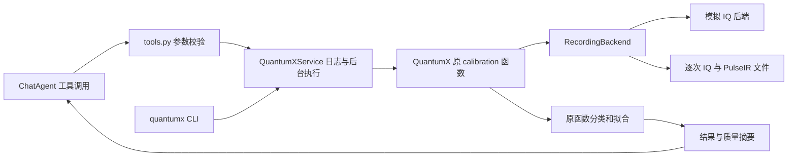

# QuantumX2 函数接入（0.4.0）

实现位置全部在 QAgent。QuantumX2 作为只读源码依赖，直接调用其 `quantumx.calibration` 公共函数，不修改原文件，不替换私有函数。

## 启动

在 `D:\QAgent\QAgent` 中执行：

```powershell
# 使用已有模型配置进行自然语言对话
.\.venv\Scripts\qagent.exe --storage runs/quantumx2 chat --runtime configs/runtime.quantumx.json
```

可依次发出三条指令，在上一项完成后再继续：

```text
使用 QuantumX 计算 q1 的读出中心
查询刚才的实验结果，数据保存在哪里？
使用刚才的读出中心候选，调整 q1 的 π 脉冲幅度
查看结果，再用这个候选配置给 q1 做一次 Ramsey 频率精调
```

模型使用 `reference_experiment_id` 把合格候选应用于下一次实验的**配置副本**。也可以不引用候选，独立调用其中任何一项。每条用户指令最多创建一个新实验，启动后在当前 CLI 进程后台运行；查询不额外采集 IQ。

启动时原有 Q0 频谱测试任务提示仍属于旧工具 `start_calibration`。QuantumX 的目标单独约定：默认允许 `n=1/2`，分别表示 `q1/q2`；不会将 Q0 自动映射为 q1。两类实验使用不同编号和查询工具。

**当前数据来自模拟器。** 这里真实运行 QuantumX2 的序列生成、IQ 分类和拟合函数，在其 `backend` 参数处注入模拟 IQ；模拟器按扫描计划生成信号，不是对 PulseIR 的完整物理仿真。没有创建真机后端，也没有连接设备。Ramsey 工具基于已有 f10 做精调，尚未接入 QuantumX 宽范围频谱搜索。

不需要模型凭证的验证入口：

```powershell
# 一次完成读出中心 → π 幅度 → Ramsey，打印三个结果摘要
.\.venv\Scripts\qagent.exe --storage runs/quantumx2 quantumx demo

# 独立执行、查询、比较、停止
.\.venv\Scripts\qagent.exe --storage runs/quantumx2 quantumx run readout_centers --params '{"n":1,"shots":512}'
.\.venv\Scripts\qagent.exe --storage runs/quantumx2 quantumx run pi_amplitude --params '{"n":1,"reference_experiment_id":"实验编号"}'
.\.venv\Scripts\qagent.exe --storage runs/quantumx2 quantumx result 实验编号
.\.venv\Scripts\qagent.exe --storage runs/quantumx2 quantumx list
.\.venv\Scripts\qagent.exe --storage runs/quantumx2 quantumx compare 实验编号A 实验编号B
.\.venv\Scripts\qagent.exe --storage runs/quantumx2 quantumx stop 实验编号
```

`quantumx run/demo` 等待本次执行结束；对话工具启动后立即返回回执。直接 CLI 每次新建预算会话，也可以在 `quantumx` 前指定 `-r 任意预算会话标识` 来累积预算。对话使用实际的对话编号累计预算。默认每个预算会话最多 8 项函数实验、500000 shots；一个 Rabi/Ramsey 函数包含多次 IQ 采集，shots 成本按采集次数累加。失败和中断保留整项预留成本，避免不确定的采集被重复使用预算。

## 代码入口



| 模块 | 作用 |
| --- | --- |
| `src/qagent/integrations/quantumx/registry.py` | 固定实验名和公共函数映射，拒绝任意导入 |
| `parameters.py` | 比特、shots、扫描网格、单位和引用编号校验 |
| `service.py` | 会话身份、预算、回执、配置快照、函数执行及查询 |
| `recording_backend.py` | 透传 session/run，逐次保存 `(shots,2)` 实数 IQ 和 PulseIR |
| `results.py` | NumPy 数据转换、非有限值处理、指标和质量判据 |
| `simulation.py` | 显式模拟 IQ，读出、Rabi、Ramsey 各自使用对应信号模型 |
| `tools.py` | 三个执行工具，以及能力查询、结果查询、列表、比较和停止工具 |
| `library.py` | 加载指定 QuantumX 源码、记录指纹、禁止生成其字节码缓存 |

默认运行配置在 `configs/runtime.quantumx.json` 中启用 `quantumx` 节点。源码路径默认为本地 `D:/QAgent/QuantumX2`，配置读取其 `configs/hardware_tmpl.json` 和 `configs/qubits_tmpl.json`。需要其他输入时，可在运行 JSON 的 quantumx 节点中指定 `hardware_config`、`qubits_config`、`allowed_qubits`。这些是可信启动配置，不开放给模型修改。

未启用该节点时，原有工具和频谱校准流程保持默认行为。原来的频率轴 `Measurement` 不用于包装振幅/延迟/制备态扫描；新实验使用独立的版本化结果记录。

## 数据位置与含义

以上命令的结果位于：

```text
D:\QAgent\QAgent\runs\quantumx2\
├── journal.sqlite                  # 原业务日志与新增 quantumx_experiments/session 表
├── quantumx-inputs/<配置指纹>/      # 输入配置副本
└── quantumx/<实验编号>/
    ├── hardware.json               # 本实验配置快照
    ├── qubits.json                 # 可包含引用的候选，仅修改此副本
    ├── acquisitions.json           # 采集顺序、shots、扫描标签、文件引用
    ├── iq-0000.npy                 # 原始逐 shot IQ，每行 [I,Q]
    ├── pulse-0000.json             # 对应 PulseIR
    ├── ...
    ├── result.json                 # 原函数结果：曲线、拟合值、原指标
    └── report.json                 # 参数、扫描轴、IQ 引用、质量、状态与源码指纹
```

`result.json` 仅在函数完成并返回可序列化结果时存在。失败或中断仍保留已有 IQ、采集清单和 `report.json`。摘要中的 `actual_measurements` 表示已保存的有效 IQ shots，失败调用内部是否完成测量不作推断；`reserved_measurements` 保留整项计划预算。运行中可查询已落盘的采集进度。模型获得指标与文件位置，不读取整组 IQ。

`completed` 仅代表函数执行完成。质量满足阈值后标记 `candidate`：读出平均保真度至少 0.8；Rabi/Ramsey 对比度至少 0.1、R² 至少 0.8。它不代表整个校准任务已通过独立验证。`T2Star` 等非有限拟合值以 JSON `null` 和说明保存。

所有原函数固定接收 `update=False`、`show_plot=False`。候选只用于明确引用它的新实验快照，不写回 QuantumX2 源配置。

退出对话会在下一次采集调用前中断；正在运行的调用会先返回。强制关闭进程时，运行状态可能仍是 queued/running，应先查询，必要时用停止工具核对并结束旧记录。原始 IQ 通过逐次原子写入保存。对话修复只找已有回执，找不到时也不会自动重放实验。配置或源码变化后，不能把原会话悄悄接到新实验上下文；应使用原配置或新会话。

## 验证范围

自动测试调用本地 QuantumX2 三个原函数，检查完整候选链、IQ 文件、扫描标签、配置副本和源码目录哈希不变；同时覆盖参数拒绝、预算和重复调用、中断与部分数据保存、模型工具路由、回执恢复以及无模型的 CLI 演示。

缺少相邻 QuantumX2 源码时，这组可选集成测试会明确跳过。未验证在线模型的自然语言决策质量，也不包含真机执行、任务级自动收敛、DRAG 或 RB 接入。
