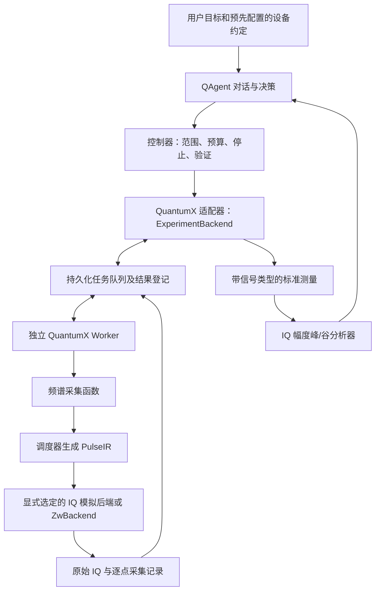

# QAgent 接入 QuantumX_v2：首版设计方案

日期：2026-11-01。状态：QuantumX 接入设计草案；QAgent 默认 IQ 基础已在 0.3.0 实现，QuantumX 适配器与 Worker 尚未实现。第 2 节的源码对照为设计时快照，最新 IQ 实现见第 14 节。

## 1. 建议与首版目标

在 QAgent 的 `ExperimentBackend` 端口后增加 QuantumX 适配器，复用 QuantumX 已有的频谱采集、PulseIR 调度及 ZW 驱动。QAgent 保留任务约定、模型决策、预算、分析和独立验证职责。

首版只做：**固定工作偏置、固定 XY 驱动幅度下，对一个明确编号的比特进行频谱扫描，迭代估计 f10，再用新采集的数据进行验证。**

首版不开放偏置搜索、读出标定、Ramsey 精调、DRAG、多比特任务或参数自动写回。这些过程分别涉及新的前提条件、数据契约与成本，后续逐项接入。

交付分为两个可区分的阶段：

1. 离线接通 QuantumX 的 PulseIR→IQ→幅度谱→分析→决策链路，明确标记模拟/回放来源。
2. 使用同一个接口接通 ZW 真机，经过单次扫描验证后启用 Agent 自适应扫描。

不把现有模拟闭环通过解释为真机校准通过，也不把同一份回放数据改名后作为独立测量。

## 2. 本次源码核对结果

实际 Python 项目根目录为 `D:\SSHProgram\QuantumX_v2\QuantumX_v2`，外面还有一层同名目录。QuantumX 当前 HEAD 为 `fae9d45`，工作树有较多未提交修改；本文依据当前工作树，不能仅凭这个提交号复原全部被分析代码。QAgent 的接入点依据本地现有实现。

| 核对项 | 当前实现 | 对设计的影响 |
| --- | --- | --- |
| 单比特频谱 | `quantumx.ssh.spectroscopy()` | 最接近 QAgent 当前实验类型的入口 |
| 输入 | `n`、Hz 频率数组、驱动幅度、shots、`response_mode`、显式配置路径 | 适配器可生成参数，无需让模型编写 Python |
| 输出 | `frequencies`、`mean_i`、`mean_q`、`amplitude`、`phase`、`best_f10` 等 NumPy 数据 | 需要新增 IQ 幅度谱契约，序列化时转成公开数据结构 |
| 频谱形状 | 支持 `peak`/`dip`，普通 spectroscopy 默认 `peak` | 由实验配置固定峰/谷模式，不能沿用正峰假设 |
| 执行粒度 | `Backend.run(PulseIR, shots)` 同步返回 `(shots, 2)` IQ | QAgent 任务接口需要一个独立的执行及任务登记层 |
| 偏置生命周期 | `ZwBackend.session()` 进入时设置全部启用的 q/c 工作偏置，退出时尝试恢复 idle 偏置 | 需要整套设备互斥，资源范围不能只按目标比特计算 |
| 当前目标编号 | 配置含 `q1`–`q15`，不含 `q0` | 新任务明确使用实际编号；逻辑名映射必须由配置声明 |
| 当前频率参考 | 例如 q1 的配置 f10 约为 4.6699 GHz | 现有 Q0/4.8–5.2 GHz 示例任务不能直接作为设备任务约定 |
| 驱动 | `ZwBackend` 延迟加载 ZW 驱动，可传 `driver_dir` | 当前默认的 `3rd_libs/ZW_driver/ZWserver` 目录不存在，实际驱动环境待核对 |
| 离线后端 | `DryRunBackend` 按理想旋转门生成 IQ | 它不建模扫频失谐，不能直接充当频谱共振模拟器 |
| 当前 QAgent 测量 | y 单位固定为 probability，限制 values 在 0–1 | 不能直接装入 IQ 幅度，也不能归一化后声称它是 P(1) |
| 当前 QAgent 分析 | 正峰 Lorentzian，基线/幅度有概率域边界 | 必须增加独立的 IQ 幅度峰/谷分析实现 |

当前 `ssh.py` 是频谱及偏置标定模块，文件名本身不表示已有 SSH 远程任务服务。

文档有滞后：`SSH_CALIBRATION.md` 部分内容仍写 P(1)，当前源码实际使用平均复数 IQ 的幅度；文档描述的 `try.py` 运行器在当前工作树中也已变化。`tests/test_ssh.py` 的一个样例生成谷形幅度，却没有显式指定 `response_mode="dip"`。接入前应同步该测试与接口语义。本轮仅静态核对，未运行设备或宣称这些测试已通过。

源码参考：

- [QAgent 实验端口](../src/qagent/backend/base.py)、[装配入口](../src/qagent/bootstrap.py)、[当前测量契约](../src/qagent/schemas.py)、[当前分析器](../src/qagent/analysis.py)。
- [QuantumX 频谱入口](../../../SSHProgram/QuantumX_v2/QuantumX_v2/src/quantumx/ssh.py)、[底层后端](../../../SSHProgram/QuantumX_v2/QuantumX_v2/src/quantumx/backend/base.py)、[ZW 执行和 session](../../../SSHProgram/QuantumX_v2/QuantumX_v2/src/quantumx/backend/zw.py)。
- [QuantumX 离线后端](../../../SSHProgram/QuantumX_v2/QuantumX_v2/src/quantumx/backend/dryrun.py)、[IQ 分类](../../../SSHProgram/QuantumX_v2/QuantumX_v2/src/quantumx/readout.py)、[Ramsey 精调](../../../SSHProgram/QuantumX_v2/QuantumX_v2/src/quantumx/calibration.py)。

## 3. 接入架构



首版假设 Worker 和 QAgent 位于同一台可访问仪器的机器，使用本机 SQLite 任务队列和文件结果，无需先引入 Web 服务。Worker 是受独立服务生命周期管理的进程，不放在交互 CLI 的 daemon 线程里。由此模型调用、关闭聊天窗口与硬件清理不会混在一个进程中。

QAgent 与 Worker 可使用不同 Python 环境：客户端只依赖中立协议；Worker 环境安装 QuantumX、NumPy 和设备驱动，不需要导入模型客户端与整个 Agent 框架。初始部署先手动启动受控 Worker，再启动 Agent，避免启动聊天隐式连接设备。

如果实际测控主机在另一台机器上，应在同一任务协议外加受控网络传输；不能跨机器共享 SQLite 文件，也不把任意 SSH 命令当实验接口。该部署分支需要在实施前确认，不由本地目录名推断。

## 4. 固定实验约定及模型权限

新增独立 QuantumX 任务配置与运行配置，使用独立存储根目录，例如 `runs-quantumx`。示例中的数值不是设备授权值；真实范围应由实验人员给出。

Worker 的可信实验 profile 固定：

- profile ID、仪器资源 ID、允许的比特及逻辑名映射；
- 明确的 hardware/qubits 配置绝对路径及内容快照；
- 允许扫描的频率范围、点数上限、shots 上限及运行时限；
- 已确认的固定驱动幅度、工作偏置、读出设置和峰/谷模式；
- 实际驱动目录、数据缩放方式及版本指纹。

例如，可以为实际 `q1` 建立 `{"q1": 1}` 映射。不能在未说明的情况下把当前用户说的 Q0 自动变成设备 q1，也不能从配置中的 f10 推导“允许的频率范围”。

Agent 首版只调整已批准范围内的 `start_hz`、`stop_hz`、`points`、`shots_per_point`。驱动幅度、偏置、设备路由、文件路径、后端模式和参数写回不作为模型自由参数。Worker 再独立检查全部输入，不能只依靠模型提示词或客户端检查。

## 5. 测量契约及数值分析

### 5.1 向后兼容的数据扩展

测量结构已增加显式版本和信号类型，IQ 为默认；旧模拟文件继续按明确的概率单位解析。表中采集身份、来源和原始结果引用仍是桥接阶段的扩展要求。

| 字段 | 设计含义 |
| --- | --- |
| `schema_version` | 新数据显式为 V2；旧数据按旧契约解释 |
| `data_type` | 默认 `iq`，兼容显式 `probability`，由适配器/profile 决定 |
| `y_unit` | 概率或缩放后的 IQ 任意单位；未经标定不能写成伏特 |
| `response_mode` | 固定的 `peak`/`dip` |
| `frequencies` | 实际使用的 Hz 数组，检查与接受的扫描一致 |
| `iq` | 默认保存 I/Q，明确 `averaged` 或 `single_shot` 及对应维度 |
| `values` | 仅用于显式概率兼容模式；IQ 的幅度另存为派生谱线 |
| `acquisition_id` | 本次真实采集的唯一标识，用于验证新测量与去重 |
| `data_origin` | `simulated`、`replay` 或 `hardware`，在界面和报告中明确显示 |
| `raw_data_ref` | 指向只读 IQ/统计文件的受控结果引用 |

IQ 模式检查每点返回恰好 `shots` 行、两列有限数，频率严格递增，所有数组长度一致。IQ 数值不执行概率域的 0–1 检查。`phase`、`mean_i`、`mean_q`、方差和逐点 IQ 存放于结果文件；模型仍主要接收分析摘要。

不能仅通过把幅度缩放到 0–1 就套用概率测量。若后续采用 `classify_iq()`，应建立另一种明确的 probability profile，要求读出中心有效并保存其版本，不与幅度谱静默切换。

### 5.2 分析器

QAgent 已按 `data_type` 区分默认 IQ 幅度与旧概率分析，核心分析不导入 QuantumX。后续可按更多信号/实验类型抽取独立的分析端口。

- 现有概率模拟分析保持兼容。
- IQ 幅度分析使用固定符号的峰/谷模型，去除现有概率域的基线和幅度边界。
- 初版只验收近似单个 Lorentzian 峰/谷；非对称谱、多峰、平坦谱、峰在边界及拟合失败，返回不可信结果，不强行宣布收敛。
- 保存拟合频率、估计不确定度、线宽、SNR、残差、方法版本和可信性判据。IQ 残差下的 SNR 与旧模拟概率数据应分别验证。
- 现有 `spectroscopy()` 的三点二次插值 `best_f10` 只作为参考，不能代替 QAgent 要求的不确定度估计和独立验证。

不把当前默认 300 kHz 精度、SNR=6 和 1 MHz 验证容差直接当成真机验收值；先按台架的线宽、噪声、频率分辨率及重复采集结果确定可用阈值。拟合协方差属于统计估计，不等于硬件准确度证明。

## 6. QuantumX 的最小接口整理

建议在 `quantumx.ssh` 提取一个公共的 `acquire_spectroscopy()`，复用当前扫描循环：

1. 检查配置、频率轴、幅度和采样数。
2. 使用显式注入的后端，进入一次 `backend.session()`。
3. 每个频率点编排 PulseIR、执行、核对 IQ 并立即交给记录器保存。
4. 完成后返回频率、IQ 均值/方差与幅度曲线，不做峰值质量判断或显示图窗。
5. 原来的 `spectroscopy()` 调用该采集函数，再完成原有拟合和绘图，维持对人工使用者的接口。

这样可以避免当前函数“采集已完成，但低对比度或边界峰导致 ValueError，调用者拿不到完整数值结果”的问题。仅设置 `show_plot=False` 不能解决这个问题。原始谱线应先落盘，后续拟合错误属于分析失败，不是“设备没有执行”。

设备模式必须由 Worker 显式构建并注入后端：当前 `backend=None` 会创建真机后端，离线测试不得触发这个默认分支。扫描辅助接口如需保存图片使用非交互方式，绘图失败不抹掉采集成功的事实。

## 7. QAgent 端口与持久化任务语义

新增客户端适配器，实现现有六个入口。

| 入口 | 首版实现约定 |
| --- | --- |
| `identity` | 仪器/profile、队列实例 ID、配置快照及协议版本的稳定指纹 |
| `capabilities()` | 返回可信 profile 的范围、采样限制和信号类型，调用本身不触发设备 |
| `submit(request)` | 事务登记 request_id 和规范化请求哈希，返回 job_id；不等待整条频谱完成 |
| `lookup(request_id)` | 查持久化登记；只有已知权威队列能确认未接收时才返回 absent |
| `status(job_id)` | 返回排队、执行、完成、失败或未知，附可公开的进度及结果引用 |
| `fetch(job_id)` | 读取已落盘的测量，转换为 V2 契约并核对请求关联 |

同一个 request_id 和同一请求返回原 job_id；同一个 ID 的不同参数被拒绝。客户端超时后先 lookup，不能生成新请求或盲目重复触发。

任务登记建议区分 `accepted → queued → execution_intent → running → completed/failed/unknown`。在第一次硬件动作之前持久化执行意图。Worker 在硬件调用前后崩溃时，不能根据进程已经退出就断言未执行，也不能自动重放半条扫描；无法确认时保持 unknown、阻止新任务，等待核对。

队列请求去重不代表硬件端能保证严格的一次执行。丢失队列数据库、换用新的空队列或配置身份不一致时不能假装旧请求 absent。Worker 重启需要核对已有运行任务及设备状态。

### 7.1 预算、停止与时限

- 一个实验请求定义为一条完整扫描，预算仍为 `points × shots_per_point`；独立验证是新的请求，另外计费。
- 队列接受后按整条扫描成本记账；中途失败也不自动释放。逐点实际计数另行记录，但首版不据此扩大剩余预算。
- 禁止隐藏的采集重试或额外读出标定；如需要辅助采集，先明确计入授权成本。
- 第一版的普通“停止”阻止下一条扫描，已经接受的当前扫描可以完成；界面明确说明停止粒度。后续逐点取消需另加显式协议。
- Worker 设置独立的设备调用/扫描时限及清理状态；QAgent 的任务总时限不能替代驱动超时。当前示例 120 秒应按实际扫描耗时重新配置。
- 所有数据接收和失败状态都保留已完成点数、已发生采集与原始结果引用。完整采集但拟合失败可重新分析，不能因此不记预算。

## 8. 真机资源和 session

当前 QAgent 的运行锁只保护单个 run_id，不能防止另一个任务操作同一套仪器。Worker 首版按整个测控 setup 串行执行，并覆盖由配置启用的全部 qubit/coupler 资源。

QuantumX 的 `ZwBackend.open()` 会设置全部启用偏置，`close()` 尝试关闭输出、恢复 inactive 偏置并关闭连接。该生命周期由 Worker 持有，不跨 LLM 决策阶段长期保持；每条扫描使用一个完整 session。

Worker 必须记录 session 打开、清理尝试及清理失败。程序异常时正常执行 finally；硬杀进程、驱动卡死或通信断开时不能保证 Python 清理执行。清理无法确认的 setup 保持不可分配，不能因 OS 锁释放而自动继续实验。

需要同一套台架上的其他脚本遵守同样的设备互斥约定；单个 Worker 无法约束绕开它直接运行的人工脚本。上线前应确认台架的驱动超时、关断和故障恢复方式。

## 9. 验证与结果保存

候选通过精度及质量判据后，发起新的物理扫描；验证使用相同的目标、固定驱动幅度、偏置、读出设置、响应类型及配置快照。核对新的 acquisition_id、数据来源、质量、估计精度和频率差。

回放模式保持原始 acquisition_id；旧数据没有采集编号时，按来源文件内容指纹建立固定身份。把同一个文件复制为两个请求不能满足独立验证；只有独立的历史采集可用于离线验证路径检查，且报告仍标记为 replay。模拟后端可以产生不同噪声的新数据，但结果仍标记 simulated。

结果采用独立的 `runs-quantumx`，避免和现有模拟任务混用。建议结构：

```text
runs-quantumx/
├── journal.sqlite
├── checkpoints.sqlite
├── bridge/
│   ├── jobs.sqlite
│   └── jobs/<job_id>/
│       ├── request.json
│       ├── manifest.json
│       ├── points/0000.npy ...
│       ├── spectrum.npz
│       ├── config-snapshot/...
│       └── worker.log
└── <run_id>/
    ├── <request_id>.json
    ├── analysis-<request_id>.json
    ├── spectrum-<request_id>.png
    └── report.json
```

manifest 记录来源、目标、参数、实际点数、时间、清理结果、源码/配置指纹及原始文件引用。内部设备地址和连接信息不进入模型上下文；公开报告保存必要的版本摘要和受控引用。原始数据和完整私有快照由设备端访问权限保护。

首次接收及质量检查失败的情况都显示实际报告/原始数据路径，避免只有随机目录名而难以查找。

## 10. 预计修改范围

下列名称均为拟新增/修改项，本设计没有实现这些代码。

| 工程 | 位置 | 修改内容 |
| --- | --- | --- |
| QAgent | `src/qagent/backend/quantumx.py` | 轻量客户端适配器，不导入设备驱动 |
| QAgent | `src/qagent/schemas.py` | 向后兼容的信号类型、来源、采集身份及结果引用 |
| QAgent | 分析模块及分析端口 | IQ 峰/谷拟合、质量判断及分析实现选择 |
| QAgent | `bootstrap.py`、控制器/报告 | 注入分析实现、核对数据来源、关联原始结果和设备状态 |
| QAgent | 对话/终端 | 根据新 profile 展示实际目标，区分模拟/回放/真机，显示报告路径 |
| QAgent | `configs/runtime.quantumx.json` 与设备任务 profile | 可信连接与实验约定，使用独立 storage |
| 独立轻量包 | `integrations/quantumx_worker/` | 队列消费者、配置快照、设备互斥、采集与结果落盘 |
| QuantumX | `src/quantumx/ssh.py` | 提取采集接口，保留原 spectroscopy 的拟合/绘图封装 |
| 两个工程 | 测试与对应文档 | 显式峰/谷、离线协议、故障恢复、驱动 session 测试 |

驱动依赖留在 Worker 环境，不直接混入 Agent 的模型/编排依赖环境。QuantumX 配置一律用显式路径，不依赖安装方式或当前工作目录下恰好存在 configs。

## 11. 分阶段实施与验收

| 阶段 | 工作 | 验收依据 |
| --- | --- | --- |
| A：接口冻结与离线数据 | 明确实际比特映射、profile；同步幅度/概率语义；保存当前源码指纹 | 离线数据可逐字段核对，现有模拟流程保持兼容 |
| B：分析与 IQ 联调 | 新建 V2 契约、IQ 峰/谷分析；显式模拟 IQ 后端穿过真实 scheduler 和采集函数 | 正峰/谷、平坦、边界、坏 IQ、非有限数等结果可重复计算，错误不误报成功 |
| C：任务与恢复 | Worker、客户端、持久化队列、互斥和结果关联 | 回执丢失、重复请求、执行中断、部分数据、清理失败都不盲目重提 |
| D：单次真机扫描 | 确认驱动及台架配置，由固定扫描请求完成一次采集 | 手工流程与桥接结果一致；配置未被写回；原始数据和清理状态完整 |
| E：受限 Agent 闭环 | 先固定基线，再显式切换模型策略，允许范围内调整频率网格/shots | 真机新测量独立验证、预算正确、来源清晰；结果不写回设备参数 |

阶段 A–C 默认不连接设备：显式注入测试后端，禁止默认 backend=None；开发测试禁用 QAgent 的真实凭证文件加载，并关闭远程追踪。保存的离线谱只验证数据与控制链路，不等价于硬件验收。

现有 `DryRunBackend` 不模拟频率失谐，需要专门的 IQ 频谱测试后端或可追溯的录制数据。使用录制数据时保留其采集身份；插值出的请求响应必须标注 replay，不能伪装成实际设备采样。

实施前仍需实验人员确定：实际目标及名称映射、允许频率与驱动幅度、固定偏置和读出条件、运行主机及驱动位置、实际精度/时限、整套设备的互斥和故障恢复约定。这些信息不从现有模拟默认值推导。

## 12. 后续扩展边界

`freqtuner()` 是 Ramsey X/Y 频率精调，扫描的是 delay，不是当前频率轴；成本通常包含每个 delay 的两条序列，不能直接套用现有 `points × shots`。需另建实验契约与分析器，仍先设置 `update=False`、`show_plot=False`。

`calibrate_f10_vs_bias()` 内部包含偏置与频率两级扫描，并有当前台架相关的固定读出偏置补偿逻辑。后续接入应拆成可计费、可停止的一偏置一点谱动作，再由工作流组织；不能把整个函数作为没有内部成本边界的单个 Agent 动作。

参数写回作为独立后续功能设计，先输出候选值、原值、验证证据与配置变更预览，再定义明确授权、版本核对和回退机制。

## 13. 本轮交付边界

本轮只新增本设计文档；未修改或运行 QuantumX 代码，未执行任何硬件操作，未读取 `.env`，也未修改已有运行数据。QuantumX 的未提交修改与 QAgent 已有的 `terminal.py` 修改保留原状。

文档交付验证：10 个本地源码链接均可解析；文档无行尾空白；5 个关键源码文件通过 AST 语法解析；`git diff --check` 通过。验证只使用标准库静态读取，没有执行项目代码。本轮没有实现代码，不把静态设计核对表述为联调或真机测试通过。

## 14. IQ 默认契约的后续实现

0.3.0 已将 QAgent 的默认契约、模拟数据、数值分析、结果保存、后端能力和模型提示统一到 IQ。默认 `iq.mode="averaged"`，可保存逐 shot I/Q；幅度由复数均值计算，单位不被伪装为概率，峰/谷模式由后端声明。每条测量保存 I/Q JSON 及 `.spectrum.json`，报告包含谱线引用。旧概率文件和旧模拟数据库保留显式兼容路径。

因此接入 QuantumX 时，数据适配应直接填充其采集返回的 I/Q，并正确声明是否已平均，不能再把幅度数组放入概率 `values`。QuantumX 的纯采集接口整理、采集身份/来源、驱动 Worker、设备互斥和真机验证仍按本设计后续实施。
